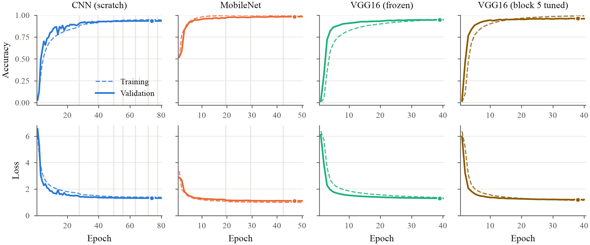

# Bird species classification with CNNs

Code for a BM616 course project at IIT Ropar (Anil Kumar, Sandeep Singh). We
train four image classifiers on a 525-species bird dataset and compare them:

- a 13-layer CNN trained from scratch
- MobileNet pretrained on ImageNet, all layers fine-tuned
- VGG16 pretrained on ImageNet with frozen convolution layers and a new dense head
- the same VGG16 with convolution block 5 also trained

The write-up is in [paper.pdf](paper.pdf).

## Data

The images come from the 525-species version of the Kaggle bird dataset by
Gerald Piosenka (CC0). The Kaggle page is no longer online, so the script
downloads a copy from Hugging Face
([chriamue/bird-species-dataset](https://huggingface.co/datasets/chriamue/bird-species-dataset)).
The split is 84,635 training images, 2,625 validation images and 2,625 test
images (5 per species), all 224 x 224.

## Results

Test set, mean and standard deviation over three training seeds (42, 43, 44).
Each test prediction averages the image and its mirror image.

| Model | Accuracy (%) | Top-5 (%) | Macro F1 |
|---|---|---|---|
| CNN (scratch) | 96.99 ± 0.31 | 99.35 | 0.969 |
| MobileNet | 99.39 ± 0.08 | 99.90 | 0.994 |
| VGG16 (frozen) | 96.81 ± 0.17 | 99.75 | 0.968 |
| VGG16 (block 5 tuned) | 98.26 ± 0.18 | 99.87 | 0.982 |

Training used one RTX 4000 Ada (20 GB). One seed of all four models took
about 11 hours.



`results/` has the per-epoch logs, test metrics (`*_eval.json`), per-species
scores and confusion matrices for every run. `figures/` has the plots made
from them.

## Files

- `paper.pdf`: the project paper.
- `bird_species.py`: downloads the data, trains and evaluates every model, then
  draws the figures. Settings are in `CONFIG` at the top.
- `plots.py`: figures and LaTeX tables, read from `results/`.
- `bird_species_colab.ipynb`: the same code as a Colab notebook, built by
  `make_notebook.py`.

## Running

On Colab, open the notebook, pick a GPU runtime and run all cells. Output goes
to `MyDrive/BM616_birds` on Google Drive, and a run that was cut off resumes
from its last epoch.

Locally:

```
pip install -r requirements.txt
python bird_species.py
```

Output then goes to `./BM616_birds`. To change settings without editing the
file, pass JSON in `BM616_CONFIG`, for example
`BM616_CONFIG='{"n_classes": 50, "models": ["mobilenet"]}'`, and set the
output folder with `BM616_OUT_DIR`.

The results above were made with Python 3.12, TensorFlow 2.21 and Keras 3.15.

## License

MIT, see [LICENSE](LICENSE).
